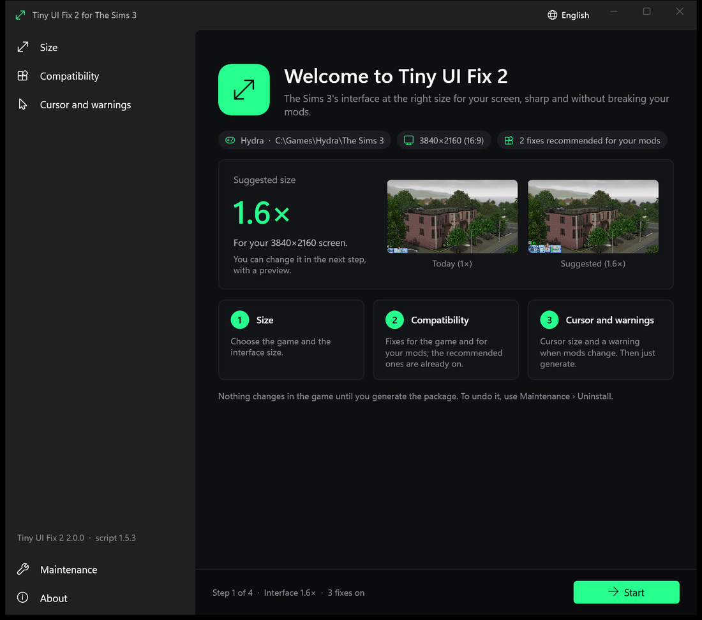
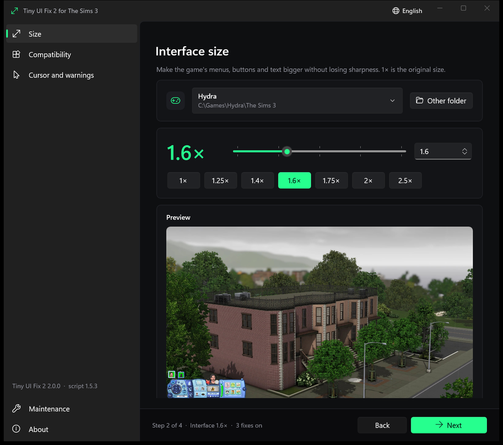
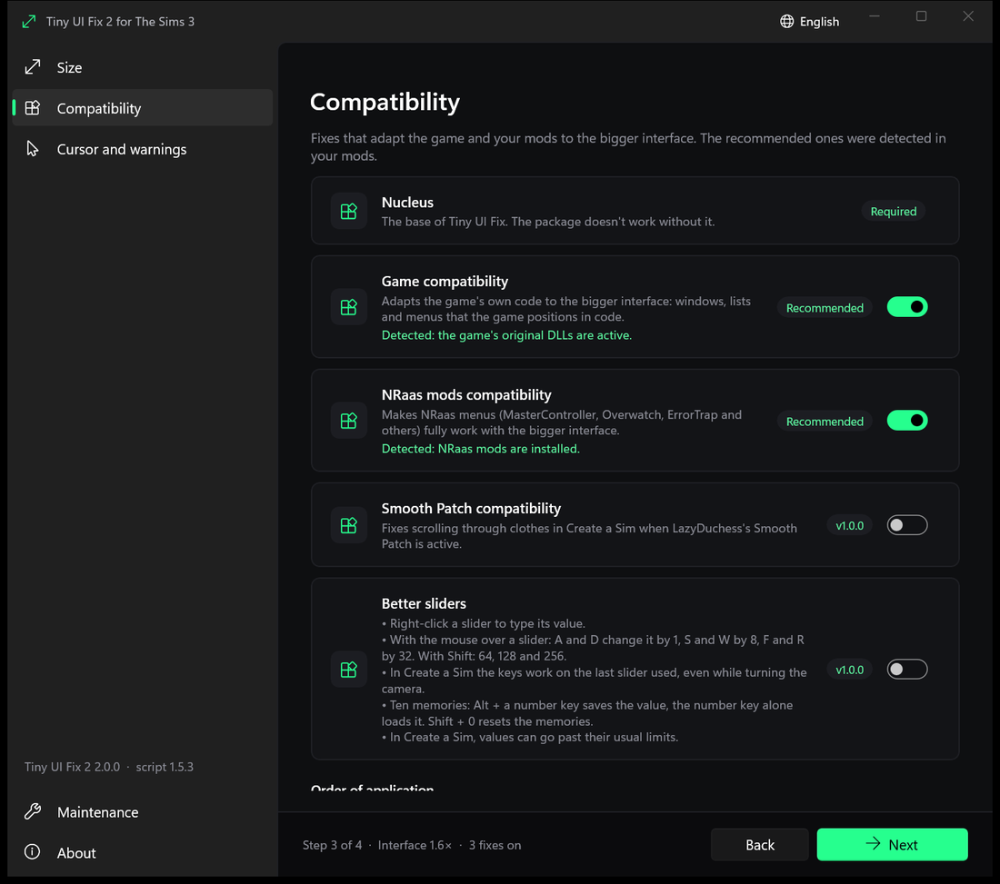

# Tiny UI Fix 2 for The Sims 3

**Tiny UI Fix 2** is a fork of [Tiny UI Fix for The Sims 3](https://github.com/just-harry/tiny-ui-fix-for-ts3) by Harry Gillanders. It keeps all of the original's UI scaling and makes it easier and friendlier to install: one Windows app instead of a script and a web page, a guided first install, a preview of the real size on your own screen, the game's 23 languages, and fixes for several scaling bugs.

Tiny UI Fix makes The Sims 3's interface bigger, without blur, on high-resolution screens. It reads your game and your mods and generates a package that scales the game's UI by any size you choose.

## Download and install

1. Download **`Tiny-UI-Fix-2.exe`** from the [latest release](https://github.com/loinyx/tiny-ui-fix-2/releases/latest). It's a single file: nothing else to download or install.
2. Close The Sims 3 and open `Tiny-UI-Fix-2.exe`.
3. Follow the steps: pick your game and a size, check the compatibility fixes, then **Generate package**.
4. Start the game.

To change the size later, open the app again and generate a new package. To remove it, use **Maintenance › Uninstall**.

Windows 10 (1809) or later, 64-bit. Works with the EA app and Steam versions of the game, and with any other copy you point it to.

## What's new in Tiny UI Fix 2

### A real app, with a guided first install

- **One file**: the app carries the Tiny UI Fix inside it and runs the same script in the background, with no PowerShell window or web page.
- **Guided first install**: welcome, size, compatibility, cursor and warnings, then generate. The app suggests a size for your screen (1× up to 1440p, 1.6× at 4K, 2× at 5K).
- **Real-size preview**: the preview is your whole screen at your game's resolution (read from the game's `Options.ini`), with the game's HUD at the size you pick. Ultrawide (21:9, 32:9) and other aspect ratios keep their real proportions.
- **Finds your game**: the EA app and Steam installs are found automatically, and **Other folder** accepts any other copy (such as one installed by another launcher).
- **Compatibility in plain words**: each fix says what it does, and the ones your mods need are detected and switched on.
- **Safe to use**: generating is blocked while the game is open, the game's `Resource.cfg` is adjusted when needed so the package loads, and nothing changes until you generate.
- **The game's 23 languages**, chosen from your Windows language (or from the language button at the top), and your Windows accent colour.
- **Fits any window**: the layout reflows at small sizes and long languages, and keeps readable line lengths on wide screens.

### Bug fixes

| Bug | Cause | Fix |
|---|---|---|
| Text looked wavy and uneven at sizes such as 1.3× or 1.5× | Scaled windows and font sizes landed between pixels (8.25pt became 16.5px at 1.5×), and edge smoothing drew each letter at a different sub-pixel offset | Scaled layout areas and font sizes are kept on whole pixels, as the game's own sizes are |
| Some text styles were lost or not scaled | The scaled style-sheets were written without flushing, so each was cut at a multiple of 1024 characters (7 of the game's sheets lost their last styles) | The writer is flushed |
| The town list in "Choose a Town" was much taller than its rows | The maximum of 15 visible rows was scaled like a size in pixels, so at 1.4× the list's background was 21 rows tall | Only the pixel sizes are scaled |
| Slider crystals in the Options were sometimes squashed | A slider's thumb was measured once, before the game had loaded its image; which sliders were affected changed each time the window opened | The thumb is measured again until its image has loaded |
| The main menu panel was glued to the bottom of the screen | The game places it 90% of the way down; scaled, it reaches the bottom edge | The main menu panels are centred |

Each fix is its own commit, so the original project can take any of them on its own.

## Languages

New in Tiny UI Fix 2: the app speaks all 23 languages The Sims 3 ships in. It follows your Windows language and can be switched any time from the language button at the top of the window.

English, Português (Brasil), Português (Portugal), Español (España), Español (Latinoamérica), Français, Deutsch, Italiano, Nederlands, Polski, Čeština, Magyar, Русский, Ελληνικά, Dansk, Svenska, Norsk, Suomi, 日本語, 한국어, 简体中文, 繁體中文, ไทย.

## How it works

The app is a front-end for the Tiny UI Fix's own script (`Use-TinyUIFixForTS3.ps1`), which it runs hidden:

- `-WriteConfiguratorStateTo <file>` (new) writes the state the web configurator would show (scales, patchsets, recommendations, load order, game and user-data folders) as JSON, without generating anything.
- Generating uses the script's existing `-NonInteractive`, `-PatchsetLoadOrder`, `-PatchsetConfiguration` and `-ChangeResourceCFGToLoadTinyUIFixLast`.
- The `TINY_UI_FIX_GAME_PATH` environment variable (new) points the script at a copy of the game outside the usual install locations.

The original `tiny-ui-fix-for-ts3.bat` and its web configurator still work as before.

## Building

- The Tiny UI Fix itself builds as before (see [the original README](README.original.md) and `Building/Build-All.ps1`, `Building/Package-SingleFileDistributables.ps1`).
- The app: `Building/Build-App.ps1 -ToolBat <path to tiny-ui-fix-for-ts3.bat>` runs the tests and publishes `Tiny UI Fix 2.exe` with the tool inside it. It needs the .NET 8 SDK.
- The app's tests run without the game: `dotnet run --project TinyUIFixForTS3/App/TinyUIFixApp.Tests` (add `-- --integration` to also read your real install, read-only).

## Credits

- **Tiny UI Fix** by Harry Gillanders ([@just-harry](https://github.com/just-harry)): all of the UI scaling, the patchsets and the script are his work.
- **Tiny UI Fix 2's new interface** (the app) and the fixes above by [@loinyx](https://github.com/loinyx).

The goal of this fork is for these changes to find their way into the original Tiny UI Fix.

## Licence

[Boost Software License 1.0](https://www.boost.org/LICENSE_1_0.txt), as the original. Mono.Cecil's licence is in `Licences/Mono.Cecil.txt`; the Windows App SDK is Microsoft's, under the MIT licence.
